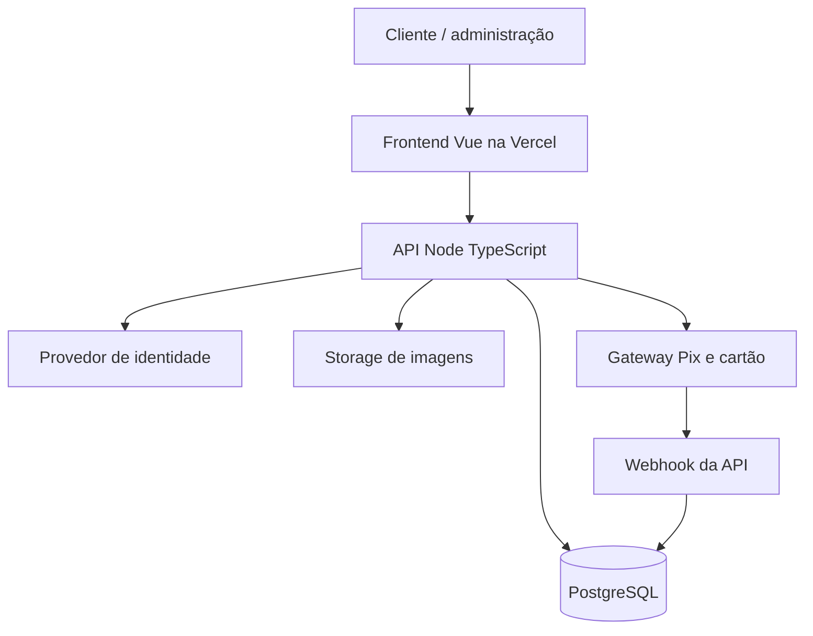

# Ambientes, custos e implantação

## Arquitetura inicial proposta

Proposta: manter o front na Vercel e avaliar um backend Node.js/TypeScript com PostgreSQL gerenciado (por exemplo, Supabase Postgres/Auth/Storage). O serviço, arquitetura de deploy e gateway ainda precisam ser escolhidos; nenhum recurso ou conta foi criado por esta modelagem.

## Desenvolvimento, preview e produção

| Ambiente | Front | API e banco | Pagamentos |
| --- | --- | --- | --- |
| Local | Vite | API local e PostgreSQL local ou projeto de desenvolvimento isolado | Sandbox e webhook local via túnel apropriado |
| Preview | Deploy de branch/PR da Vercel, conforme configuração existente | Projeto não produtivo isolado; seed sem dados reais | Credenciais sandbox e webhook de teste |
| Produção | Deploy de produção Vercel | Banco e storage de produção isolados, com migrações e backups | Credenciais de produção e webhook de produção |

- URLs, segredos, credenciais e configuração por ambiente ficam no serviço de hospedagem, nunca no código ou em `VITE_` quando secretos. A chave pública do provedor, se aplicável, pode ser exposta conforme documentação do gateway.
- Uma configuração alterna **conexões entre ambientes já provisionados**. Escalar o mesmo provedor pode exigir upgrade/ajuste de capacidade; migrar para outro exige plano de dados, compatibilidade de autenticação/storage, migrações, teste e janela de corte.
- Não conectar Preview ao banco ou gateway de produção. Confirmar branch de produção configurada na Vercel antes de alterar fluxos de deploy.
- Não há garantia de que todas as aplicações comerciais se enquadram no plano gratuito da hospedagem ou do banco: conferir termos e cotas antes do lançamento.

## Ponto de partida de custo

Em 11/11/2026, a página oficial do [Supabase](https://supabase.com/pricing) informa plano Free de US$ 0/mês, com 500 MB de banco por projeto, 1 GB de armazenamento de arquivos e até dois projetos ativos gratuitos; projetos gratuitos podem ser pausados após inatividade. A [documentação de cobrança](https://supabase.com/docs/guides/platform/billing-on-supabase) detalha outras cotas. São limites sujeitos a alteração, elegibilidade e consumo compartilhado; verificar antes de contratar.

Dois projetos gratuitos podem acomodar desenvolvimento/preview compartilhados e produção **em avaliação**, mas isso não equivale a uma operação comercial com disponibilidade, suporte, restauração ou capacidade garantidos. O custo final também inclui gateway, domínio, e-mails, frete, eventuais notas fiscais e tráfego, e pode deixar de ser zero. Não colocar pedidos reais em operação sem validar termos, backups e recuperação.

A imagem enviada menciona orçamento AWS; ela não comprova saldo, elegibilidade ou qual serviço será usado. A [AWS](https://aws.amazon.com/free/free-tier-faqs/) informa que a elegibilidade para créditos depende da conta e que ofertas gratuitas têm limites e condições. Não presumir que uma conta já existente receberá novos créditos. Consultar o painel de faturamento antes de usar AWS.

## Sequência de implementação

1. Confirmar provedor de banco/autenticação e gateway; desenhar API e contratos, escolher repositório e ambientes.
2. Configurar migrações PostgreSQL, seed da Aegon e testes de isolamento multiloja. Criar somente tabelas do MVP.
3. Implementar autenticação, papéis, catálogo, categorias, variantes e upload de imagens.
4. Implementar carrinho anônimo/autenticado, cálculo no servidor, cupom, endereço e pedido com snapshots.
5. Implementar reserva de estoque, tentativas de pagamento, webhook idempotente e conciliação em sandbox.
6. Implementar envio/rastreio, painel com permissões, observabilidade e testes integrados. Somente então avaliar lançamento real.
7. Evoluir para campanhas, comentários, favoritos sincronizados, métricas e múltiplas lojas comerciais conforme necessidade.

## Critérios mínimos antes de cobrança real

- Dois tenants testados sem acesso cruzado; permissões de equipe verificadas no servidor.
- Testes de concorrência de estoque/cupom e idempotência de pedido, cobrança e webhook.
- Valores recalculados no servidor; cartão capturado por componentes seguros do gateway, sem armazenar PAN/CVV.
- Pedido e endereço históricos, estados de pagamento e envio coerentes, e recuperação de falhas entre API e gateway.
- Credenciais e dados de teste isolados de produção; backup/restauração ensaiados; monitoramento e limites de custos configurados.
