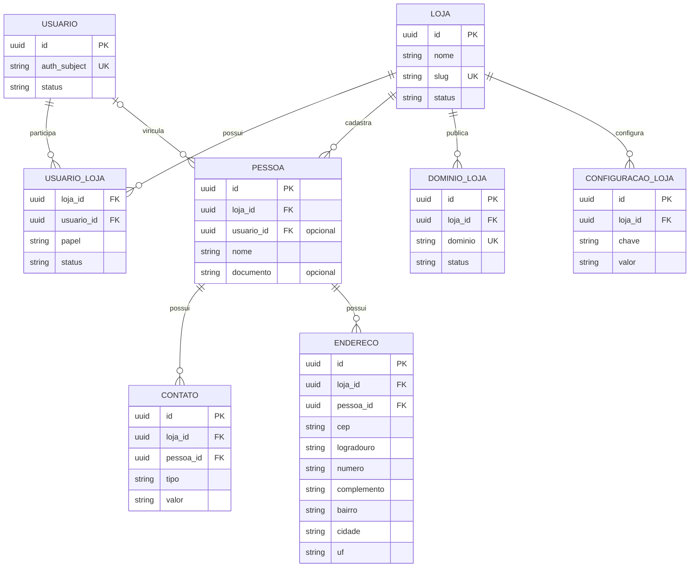
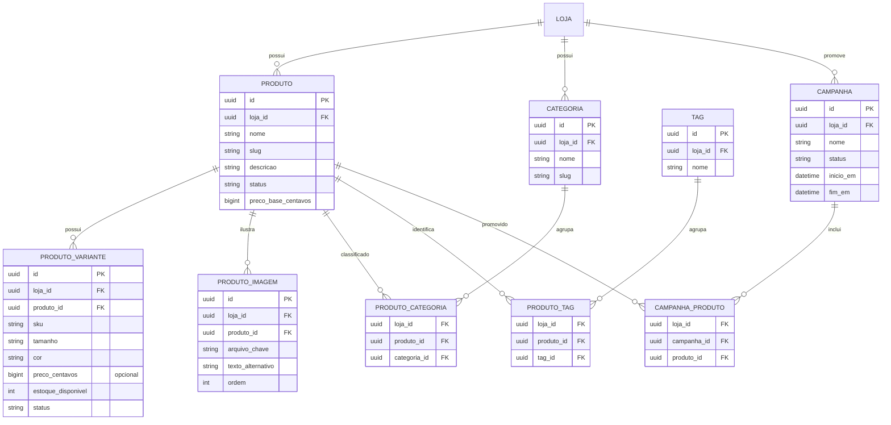
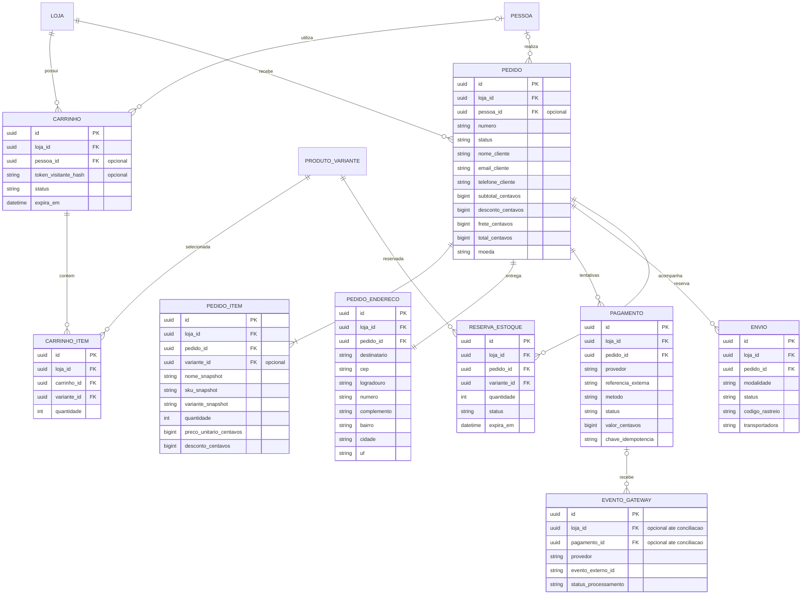
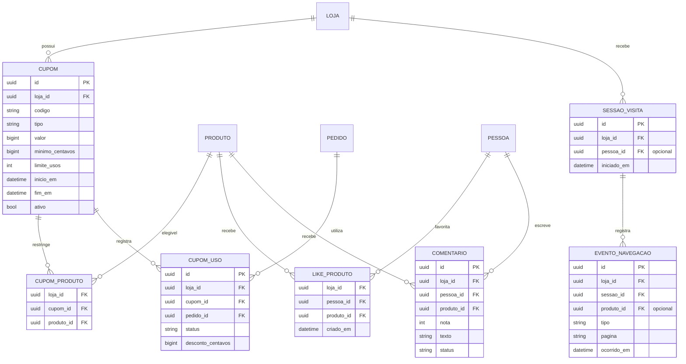

# Modelo de entidades e relacionamentos

Os diagramas são **lógicos**, não representam um SQL executável. `loja_id` é obrigatório nas tabelas da loja, exceto na entrada interna de eventos de gateway ainda não conciliados; a tabela `usuario` é global para permitir uma conta operar em mais de uma loja. Endereços de pedido são cópias históricas, não dependem do cadastro atual do cliente.

## 1. Lojas, identidade e clientes

| Entidade | Finalidade e regras principais | Etapa |
| --- | --- | --- |
| `loja` | Empresa/tenant; a primeira linha será Aegon. `slug` é único. | MVP |
| `usuario` | Identidade autenticada; `auth_subject` referencia o provedor de identidade, sem guardar senha própria. | MVP |
| `usuario_loja` | Vínculo e autorização por loja: `owner`, `admin`, `operador` ou `cliente`. Único por `(loja_id, usuario_id)`. Clientes visitantes não precisam ter vínculo. | MVP |
| `pessoa` | Cadastro de uma pessoa em uma loja, opcionalmente vinculado a usuário. Uma pessoa sem usuário permite compra como visitante. Um usuário pode ter perfil em várias lojas. | MVP |
| `contato` | E-mail ou telefone da pessoa, com tipo e indicação de principal. A compra guarda cópia do contato no pedido. | MVP |
| `endereco` | Endereços reutilizáveis da pessoa. CEP pode ser ausente enquanto a política de entrega não exigir um válido; não simular cálculo de frete real sem essa informação. | MVP |
| `dominio_loja` | Mapeamento de domínio/subdomínio verificado para loja. | SaaS |
| `configuracao_loja` | Chaves permitidas de apresentação ou comportamento, sem segredos do gateway. Única por `(loja_id, chave)`. | MVP |

## 2. Catálogo, categorias e campanhas

| Entidade | Finalidade e regras principais | Etapa |
| --- | --- | --- |
| `produto` | Descrição, preço base, status e publicação. `slug` único por loja; produto com vendas é arquivado, não apagado fisicamente. | MVP |
| `produto_variante` | SKU, tamanho/cor, preço opcional e estoque. Produto sem tamanho também possui uma variante padrão. SKU único por loja. | MVP |
| `produto_imagem` | Chave do arquivo em storage e ordem; arquivos ficam fora do banco, não em base64. | MVP |
| `categoria` / `produto_categoria` | Várias categorias por produto. Associação única por loja, produto e categoria. | MVP |
| `tag` / `produto_tag` | Etiquetas e filtros; associação única por loja, produto e tag. | MVP |
| `campanha` / `campanha_produto` | Divulgação, datas e associação com produtos. Não altera preço por si só. | Posterior |
| Lançamento | Na primeira versão, tratar como campanha do tipo lançamento ou datas de publicação do produto; criar entidade específica somente se houver regras próprias. | Posterior |

## 3. Carrinho, pedidos, pagamento e envio

| Entidade | Finalidade e regras principais | Etapa |
| --- | --- | --- |
| `carrinho` / `carrinho_item` | Carrinho de visitante por token aleatório armazenado como hash ou da pessoa autenticada. Token é credencial de acesso, nunca apenas ID público. Item único por carrinho e variante. | MVP |
| `pedido` / `pedido_item` / `pedido_endereco` | Compra, itens e endereço em snapshots históricos. Número único por loja. Valores são calculados no servidor em transação. | MVP |
| `pagamento` | Uma tentativa de Pix ou cartão por registro; aceita várias tentativas para um pedido. Nenhum dado sensível de cartão. | MVP com gateway |
| `evento_gateway` | Deduplicação e auditoria de webhooks; ID externo único por provedor/conta. O evento pode chegar antes do vínculo: guardar referência externa e permitir pagamento/loja nulos até conciliação segura. | MVP com gateway |
| `envio` | Modalidade e rastreio; admite vários envios por pedido para divisão futura. Status de pagamento é separado do envio. | MVP básico |
| `reserva_estoque` | Reserva por pedido/variante com expiração; cria, confirma e libera em transação. | MVP com gateway |

## 4. Descontos e engajamento

| Entidade | Finalidade e regras principais | Etapa |
| --- | --- | --- |
| `cupom` | Código único por loja, tipo `percentual`, `fixo` ou `frete`; valor percentual em pontos-base (10000 = 100%), os demais em centavos. Limites/datas validados no servidor. | MVP se cupom fizer parte do primeiro checkout |
| `cupom_produto` | Associa produtos elegíveis; ausência de linhas significa aplicação geral sujeita às outras regras. | MVP com cupom |
| `cupom_uso` | Reserva, confirmação e cancelamento de uso por pedido, para impedir que tentativas concorrentes ultrapassem o limite. | MVP com cupom |
| `like_produto` | Favorito único por loja, pessoa e produto. Visitantes mantêm favorito local até eventual sincronização. | Posterior |
| `comentario` | Avaliação autenticada e moderada; definir se exige compra verificada. | Posterior |
| `sessao_visita` / `evento_navegacao` | Visualização, clique, hover e etapas de funil. Eventos de pagamento confirmado são originados no backend. Agregar e limitar retenção. | Posterior |

## Índices e restrições iniciais

- Índices compostos para acesso por loja: produtos `(loja_id, status, created_at)`, pedidos `(loja_id, created_at)`, e eventos `(loja_id, ocorrido_em)`.
- Unicidade por loja: `produto.slug`, `categoria.slug`, `produto_variante.sku`, `pedido.numero` e código normalizado de `cupom`.
- `quantidade > 0`, preços/estoque/descontos não negativos, totais consistentes e UF em lista válida. Uma única linha de endereço de entrega por pedido.
- Registro de webhook único pelo identificador do provedor e da conta de integração; chave de idempotência única no escopo da loja e operação.
- Adicionar índices nas FKs e testar planos de consulta com dados reais; os índices propostos são ponto de partida, não garantia de desempenho.
