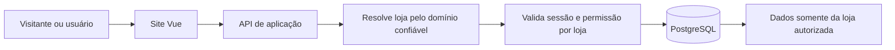
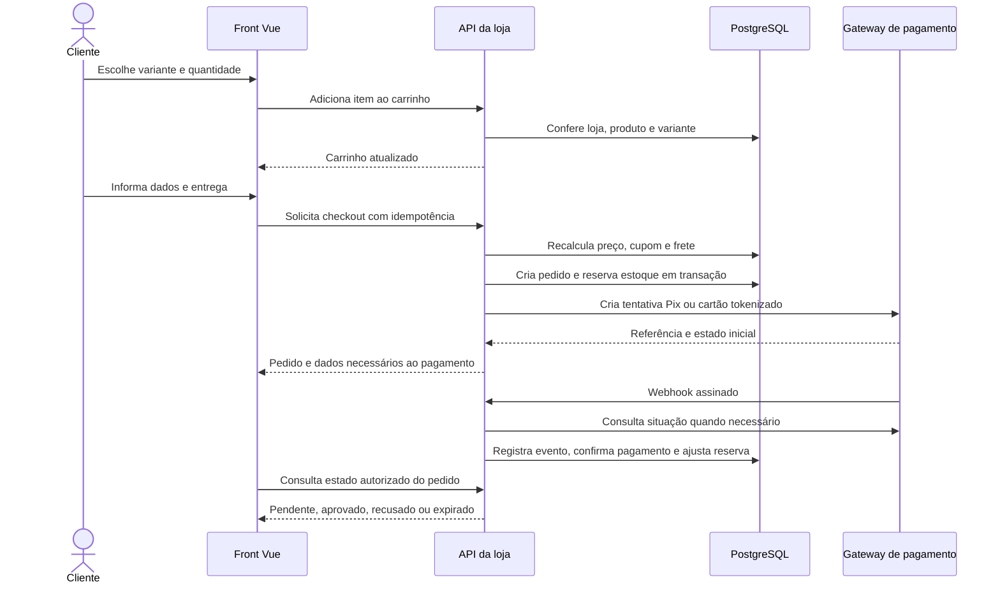

# Regras, segurança e fluxos

## Isolamento entre lojas

1. Resolver o domínio para uma loja cadastrada e verificada, a partir do host validado pela infraestrutura. Não aceitar `loja_id` informado no corpo como autorização nem confiar em cabeçalhos de proxy enviados diretamente pelo cliente.
2. Em todas as operações, usar o contexto da loja estabelecido pelo servidor; em rotas administrativas verificar sessão válida, vínculo ativo e papel permitido. Não depender de ocultar botões no Vue.
3. Adotar menor privilégio para conexão do banco. Se houver acesso direto do cliente ao Supabase, exigir políticas RLS por operação e tenant para **todas** as tabelas expostas, inclusive associações e storage; testar também acesso anônimo e dados de outra loja. A chave de serviço nunca vai para o navegador e ignora RLS.
4. FKs compostas e restrições no banco devem impedir associações entre lojas. Cobrir com testes de integração usando pelo menos duas lojas, usuários com papéis diferentes e acesso sem sessão.
5. Autorização do pedido de visitante exige token opaco secreto, com hash no servidor, validade e escopo; ID do pedido, CPF, e-mail ou código de rastreio isolados não bastam. Usuário autenticado só acessa pedidos vinculados a si; equipe da loja acessa conforme papel.
6. Identidade, e-mail e dados pessoais são globais apenas quando necessário. Cada `pessoa` e contato comercial pertence à loja. Evitar expor a uma loja quais outras lojas um usuário frequenta.

## Jornada de compra proposta

- **Preço:** servidor lê preço vigente da variante, disponibilidade e cupom; recalcula subtotal, desconto e frete. Não receber total como fonte de verdade.
- **Histórico:** copiar nome, SKU, opções, preço e desconto em `pedido_item`; copiar nome/contatos e endereço para o pedido. Alterar produto, pessoa ou endereço depois não altera compras antigas.
- **Estoque:** reservar quantidade atomicamente, com verificação de saldo e bloqueio apropriado; reserva possui vencimento. Confirmação consome a reserva; cancelamento/expiração a libera de forma idempotente. Definir política final (momento da reserva e duração) com o gateway.
- **Cupom:** validar elegibilidade, datas, limite e pedido mínimo no servidor. Contabilizar reservas e usos confirmados atomicamente para evitar ultrapassar limites; liberar reserva ao cancelar/expirar. Um mesmo pedido não consome o mesmo cupom duas vezes. Decidir se o MVP permite um cupom por pedido; esta é a suposição inicial.
- **Pagamento:** usar SDK/componentes seguros do provedor para tokenização; guardar só IDs de referência, status e informações não sensíveis necessárias. A tela de sucesso não confirma pagamento por si só.
- **Webhook:** validar assinatura conforme provedor, verificar conta e loja vinculadas, deduplicar e processar reentregas de forma idempotente. Consultar o gateway para confirmação quando exigido. Lidar com eventos duplicados, fora de ordem e referência ainda desconhecida; não confiar no browser para marcar pedido como pago.
- **Entrega:** pagamento aprovado habilita separação conforme política da loja. Código de rastreio pertence ao envio; etiqueta real depende de integração com transportadora/Correios.
- **Confiabilidade:** chamada ao gateway não deve ocorrer dentro de uma transação de banco longa. Persistir intenção com idempotência, chamar gateway e conciliar resultado; tratar falhas entre etapas com reprocessamento seguro. Uma expiração de pedido e webhook concorrentes precisam de transições transacionais.

## Estados iniciais sugeridos

| Objeto | Estados | Observação |
| --- | --- | --- |
| Carrinho | `aberto`, `convertido`, `expirado` | Um carrinho convertido não é reutilizado. |
| Pedido | `aguardando_pagamento`, `pago`, `cancelado`, `expirado` | Separar estado comercial do envio e do pagamento. Estorno pode exigir estado adicional. |
| Pagamento | `criado`, `pendente`, `aprovado`, `recusado`, `cancelado`, `expirado`, `estornado` | Mapear estados reais conforme gateway; não pressupor que todos os provedores usem esses nomes. |
| Reserva de estoque | `ativa`, `consumida`, `liberada`, `expirada` | Consumo/liberação uma única vez. |
| Uso de cupom | `reservado`, `confirmado`, `cancelado` | Contadores devem considerar usos reservados e confirmados. |
| Envio | `pendente`, `separando`, `enviado`, `entregue`, `cancelado` | Rastreio e eventos dependem da transportadora. |

## Privacidade e rastreabilidade

- Definir política de retenção e tratamento de dados pessoais com responsável pela operação. Coletar apenas o necessário, evitar CPF em logs e não gravar endereço ou telefone em eventos de clique.
- Os eventos analíticos devem usar IDs pseudônimos e não incluir conteúdo de campos, senhas ou dados de pagamento; definir consentimento e retenção antes de ligá-los em produção.
- `usuario_loja` delimita permissões; manter auditoria administrativa separada para criação/alteração de preço, cupom, estoque e status do pedido.
- Backups, restauração, exportação e remoção/anonimização precisam considerar retenção fiscal e legal aplicável, sem assumir que excluir uma conta apaga um pedido histórico imediatamente.

## Migração do estado atual

1. Criar loja Aegon, categorias, produtos, variantes e imagens por migração/seed reexecutável, preservando correspondência entre IDs antigos e novos.
2. Substituir leitura do catálogo em `localStorage` pela API. Manter fallback explícito apenas em ambiente de desenvolvimento.
3. Migrar carrinho local de modo controlado: mapear IDs, descartar itens indisponíveis e atualizar preços consultando o servidor. Sem transferência silenciosa de pedidos simulados como vendas reais.
4. Criar autenticação de equipe e isolamento por loja; o painel deve consumir a API depois de protegido.
5. Substituir cupons e checkout local por fluxos do servidor e gateway em sandbox. Manter dados simulados identificados e separados de produção.

## Decisões pendentes

- Gateway, modalidade de cartão e regras de parcelamento/antifraude.
- Checkout anônimo versus conta obrigatória; a proposta permite ambos.
- Contratação de frete, política de reserva, expiração do Pix e tratamento de reembolso.
- Quem pode administrar produtos, pedidos e campanhas em cada loja.
- Necessidade de nota fiscal, regras de CPF/CNPJ, emissão e retenção de dados.
- Quando implementar comentários, campanha, likes e coleta de eventos.
